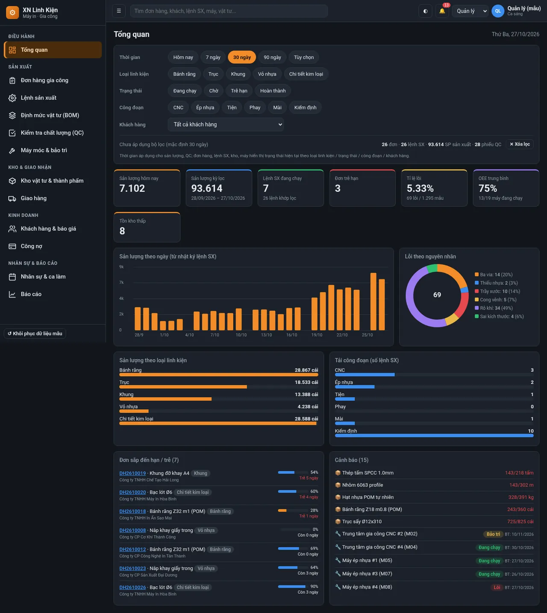
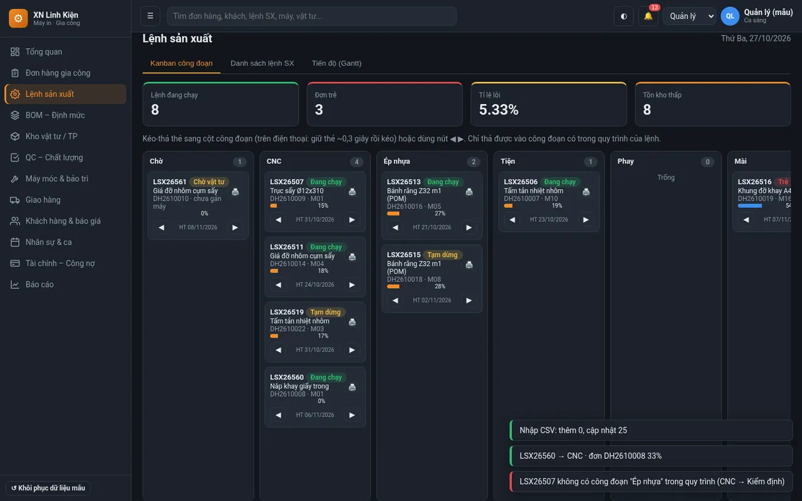
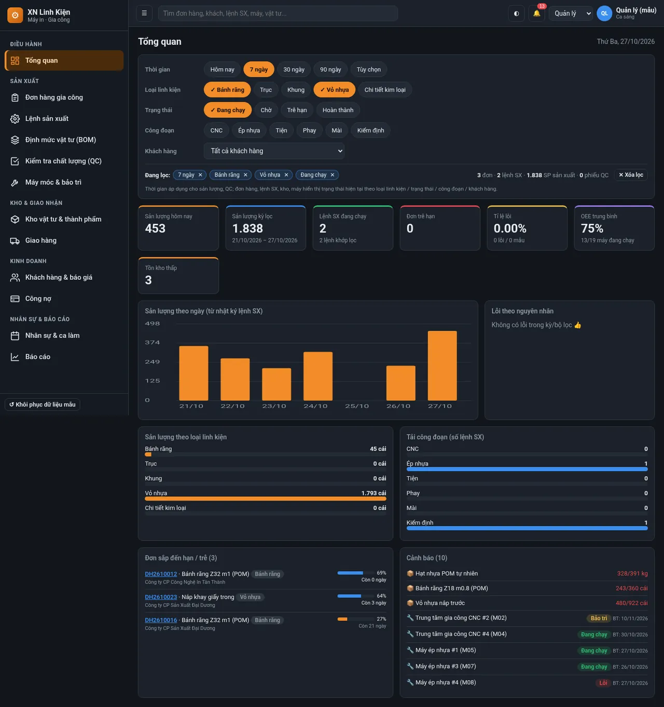
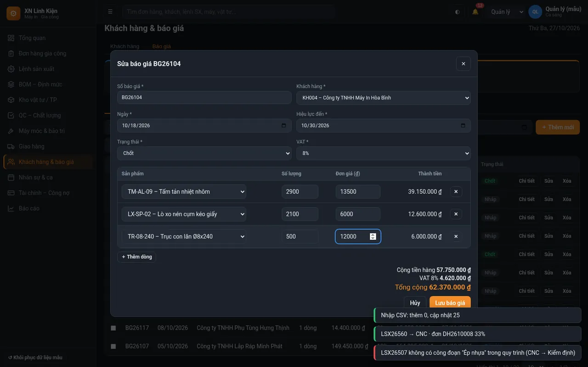
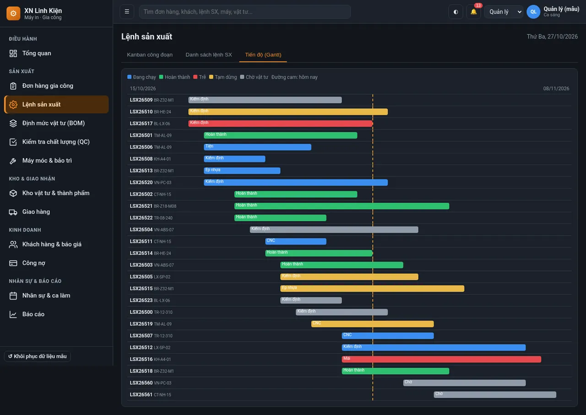
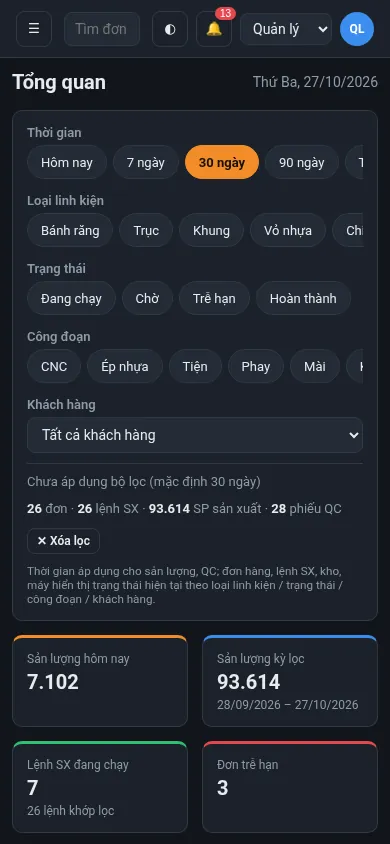

# XN Linh Kiện Máy In – Web app quản lý sản xuất (bản mẫu)

Web app quản lý sản xuất cho một xưởng gia công linh kiện máy in (bánh răng, trục, khung, vỏ nhựa, chi tiết kim loại). Viết bằng **HTML/CSS/JavaScript thuần**: không backend, không framework, không CDN. Toàn bộ dữ liệu là **dữ liệu mẫu giả**, lưu trong `localStorage` của trình duyệt.

**Bản chạy thử:** https://xnlinhkien.myagentvn.com

> **English summary:** A front-end-only production management demo for a printer-parts machining workshop (orders, work orders, Kanban, Gantt, BOM, inventory, QC, machines, shifts, quotes, delivery, receivables, reports). Pure HTML/CSS/JS, no backend or framework; all data is fake sample data stored in the browser's `localStorage`. Live demo: https://xnlinhkien.myagentvn.com. Run it by opening `index.html` or with `python3 -m http.server 8080`.

## Ảnh chụp

| Tổng quan (slicer lọc KPI, biểu đồ) | Kanban kéo-thả công đoạn |
|---|---|
|  |  |
| **Tổng quan đang lọc** | **Báo giá nhiều dòng (VAT)** |
|  |  |
| **Kế hoạch dạng Gantt** | **Giao diện điện thoại** |
|  |  |

## Tính năng chính
- **13 module**: tổng quan, đơn hàng gia công, lệnh sản xuất (Kanban, Gantt), định mức vật tư (BOM), kiểm tra chất lượng (QC), máy móc & bảo trì, kho vật tư & thành phẩm (thẻ kho), giao hàng, khách hàng & báo giá, công nợ, nhân sự & ca làm, báo cáo.
- **Slicer trang Tổng quan**: lọc theo thời gian, loại linh kiện, trạng thái, công đoạn, khách hàng; KPI, biểu đồ và cảnh báo cập nhật đồng thời, nhớ lựa chọn trong `localStorage`.
- **Kanban kéo-thả** (điện thoại: giữ ~0,3 s rồi kéo), cập nhật tiến độ đơn và ghi nhật ký sản lượng.
- **Bảng dữ liệu dùng chung**: tìm kiếm, lọc cột, sắp xếp, **tùy chỉnh cột**, **bộ lọc đã lưu**, **sửa tại ô** (nhấp đúp, Enter lưu, Esc hủy, có kiểm tra dữ liệu).
- **Báo giá nhiều dòng**: tự tính thành tiền, VAT 0/8/10%, tổng cộng.
- **In phiếu lệnh SX** và **in nhãn** QC/kho có mã vạch Code 128 SVG tự vẽ.
- **Xuất / nhập CSV** ở các bảng chính (trùng mã → cập nhật, mã mới → thêm).
- **Vai trò demo**: Quản lý, Kế hoạch, Kho, QC, Thợ (phân quyền mẫu, không có đăng nhập).
- Biểu đồ SVG tự vẽ, giao diện tối/sáng, responsive, sidebar thu gọn, tìm kiếm toàn cục, thông báo, modal xác nhận.

## Cách chạy
- Mở trực tiếp `index.html` bằng trình duyệt, hoặc
- `python3 -m http.server 8080` trong thư mục dự án rồi vào http://localhost:8080

Khôi phục dữ liệu: bấm **↺ Khôi phục dữ liệu mẫu** cuối sidebar (hoặc xóa khóa `xnlk_db_v3` trong `localStorage`).

## Cấu trúc
```
index.html        khung: sidebar, topbar, modal, toast
css/app.css       giao diện (tối/sáng, responsive, in)
js/data.js        sinh dữ liệu mẫu + lưu localStorage
js/ui.js          bảng dữ liệu chung, form/validate, toast, biểu đồ SVG, xuất CSV
js/modules.js     các module & tab
js/app.js         hash-router (#/module/tab), tìm kiếm toàn cục, thông báo, giao diện
screenshots/      vài ảnh chụp tiêu biểu
```

## Giới hạn
- **Không có backend**: không máy chủ, không cơ sở dữ liệu; mọi thay đổi chỉ nằm trong `localStorage` của trình duyệt đang dùng, xóa dữ liệu trình duyệt là mất.
- **Dữ liệu giả**: tên công ty, khách hàng, đơn hàng, số liệu đều là mẫu, không phải dữ liệu thật.
- **Không có đăng nhập**: vai trò chỉ để minh họa phân quyền, không bảo mật.
- Đây là bản mẫu (prototype) để trình diễn giao diện và luồng nghiệp vụ, chưa dùng cho sản xuất thật.

---
Tác giả: Nguyễn Văn Tùng (PeterPark) · https://portfolio.myagentvn.com
